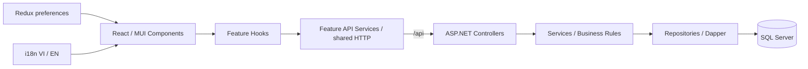
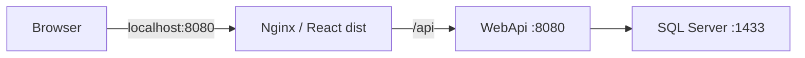

# HDS Management System

HDS quản lý danh mục sản phẩm và chỉ thị xuất hàng: CRUD, tìm kiếm/phân trang, nhập/xuất Excel, in phiếu PDF và báo cáo doanh thu. Frontend dùng React; Backend ASP.NET Core truy cập SQL Server bằng Dapper.

Các chức năng đã có mã triển khai và được kiểm tra bằng unit/component tests, API integration tests và SQL Server tạm. Đây chưa phải cấu hình triển khai production hoàn chỉnh: API chưa có authentication/authorization policy; cấu hình TLS, tài khoản SQL tối thiểu quyền và điều kiện license cần được xác định theo môi trường sử dụng.

## Technology Stack

Các phiên bản dưới đây lấy từ package.json/csproj và cấu hình container, không khẳng định mọi dependency bắc cầu đã được khóa:

| Tầng | Công nghệ thực tế |
| --- | --- |
| Frontend | React/React DOM 19.3.1, Vite 8.3.5, MUI 9.5.0 + Emotion |
| Trạng thái/ngôn ngữ/thông báo | Redux Toolkit 2.14.0, react-redux 9.3.1, i18next 26.7.1, react-i18next 17.1.12, SweetAlert2 11.26.25 |
| Backend | ASP.NET Core / net10.0, Microsoft.AspNetCore.OpenApi 10.0.14 |
| Data access/database | Dapper 2.1.89, Microsoft.Data.SqlClient 7.1.1, SQL Server 2022 |
| Tài liệu | EPPlus 8.7.2, QuestPDF 2026.9.1, QRCoder 1.8.1 |
| Backend testing | xUnit 2.9.3, Microsoft.NET.Test.Sdk 17.14.1, Microsoft.AspNetCore.Mvc.Testing 10.0.14, Coverlet collector 10.1.0 |
| Frontend testing | Vitest 5.1.0 + coverage-v8 5.1.0, React Testing Library 16.3.3, user-event 14.6.9, jsdom 31.0.0; lint bằng oxlint |
| Đóng gói/CI | Docker multi-stage, Compose, Nginx unprivileged; GitHub Actions CI và GHCR publishing thủ công |

## Project Architecture



```text
WebApp/src/
  app/                  # App, providers, navigation, Redux store
  features/
    products/           # components / hooks / api / utils / config
    saleouts/           # components / hooks / api / utils / config
  shared/               # shared UI, pagination hook, HTTP, i18n, alerts, decimal rules
  locales/              # vi.json / en.json
  test/                 # integration/architecture tests và setup
WebApi/
  Controllers/          # HTTP routes, status codes, model binding
  Services/             # nghiệp vụ, Excel import/export, PDF/report
  Repositories/         # Dapper queries, transactions, SQL errors
  Models/               # DTOs, validation, decimal và sale-out rules
  Errors/               # ProblemDetails filter/exception handler
  Sql/                  # schema.sql, fnSaleOutReport.sql, init.sh
WebApi.Tests/           # unit, validation, API tests, integration/SQL tests
scripts/                # runtime smoke, isolated write smoke, SQL test runner
.github/workflows/      # ci.yml / publish.yml
compose*.yml            # base / optional local ports / temporary CI database
TEST_COVERAGE_REPORT.md # phương pháp đo, inventory, số liệu và khoảng trống
```

Dependency hướng `app → features → shared`; shared không import feature. SaleOuts đọc lựa chọn sản phẩm qua public API của Products. Redux chỉ giữ ngôn ngữ và tab đang mở; dữ liệu nhập, dialog và danh sách/phân trang vẫn là state local trong hooks. Các thông báo SweetAlert và chuỗi giao diện sử dụng từ điển VI/EN.

Backend giữ luồng Controller → Service → Repository. Service xác thực trường tìm kiếm và chuẩn bị dữ liệu; Repository tham số hóa giá trị truy vấn, đối chiếu sản phẩm và giữ transaction. Không có ORM migration hay background worker.

## Installation & Configuration

Yêu cầu: .NET SDK 10.0.x; Node `^22.22.2 || ^24.15.0 || >=26.0.0` theo engines; npm; SQL Server. Docker stack/test SQL dùng SQL Server 2022 Linux amd64, cần RAM phù hợp (ít nhất khoảng 2 GB cho SQL; nên cấp Docker từ 4 GB cho toàn stack). Compose CI override dùng custom tags, cần Compose >= 2.24.4.

### SQL Server và cấu hình Backend

Nếu chưa có `.env`, sao chép `.env.example` rồi điền mật khẩu SQL riêng. Không ghi đè `.env` đang dùng và không commit credentials.

```bash
cp .env.example .env
# Chỉnh .env bằng editor; giữ MSSQL_SA_PASSWORD ở local.
docker compose -f compose.yml -f compose.local.yml up -d db db-init
```

Lệnh trên khởi động SQL trên loopback và chạy init. Với SQL Server cài ngoài Docker, dùng SQL client chạy lần lượt `WebApi/Sql/schema.sql` và `WebApi/Sql/fnSaleOutReport.sql`; công cụ phải hiểu batch `GO`. Database thực tế là `HDS_Intern`. Script tạo đối tượng còn thiếu, không seed dữ liệu và không tự migrate schema cũ không tương thích. Không chạy script lên database đang dùng nếu chưa đánh giá/backup phù hợp.

Backend cần khóa `ConnectionStrings:DefaultConnection`: dùng biến môi trường `ConnectionStrings__DefaultConnection` hoặc user-secrets cho Development. Nhập connection string của môi trường local vào biến shell, không đưa giá trị thật vào tài liệu/Git:

```bash
read -r -s -p 'Local SQL connection string: ' HDS_SQL_CONNECTION
printf '\n'
dotnet user-secrets set 'ConnectionStrings:DefaultConnection' "$HDS_SQL_CONNECTION" --project WebApi
unset HDS_SQL_CONNECTION
dotnet restore WebApi.Tests/WebApi.Tests.csproj
dotnet run --project WebApi --launch-profile http
```

HTTP API: `http://localhost:5252`. Kiểm tra đọc an toàn: `curl -f http://localhost:5252/api/database/check`. OpenAPI JSON chỉ có trong Development tại `/openapi/v1.json`; không có Swagger UI được cấu hình sẵn. Profile `https` có cổng 7283, cần chứng chỉ development hợp lệ.

### Frontend

```bash
npm ci --prefix WebApp
npm run dev --prefix WebApp
```

Mở `http://localhost:5173`. Vite proxy `/api` tới `http://localhost:5252`; không cần cấu hình CORS cho luồng này. Production vẫn gọi `/api` cùng origin qua Nginx. Không đưa secrets vào `VITE_*`.

## Features và API Documentation

**Sản phẩm:** mã/tên bắt buộc, giới hạn độ dài theo DTO; mã duy nhất theo SQL index. Khi sửa chỉ cập nhật đơn vị, quy cách, số lượng/thùng và trọng lượng; mã/tên giữ nguyên. Số sản phẩm không âm, tối đa 3 chữ số thập phân trong giới hạn decimal(18,3). Xóa sản phẩm đang được tham chiếu trả 409.

**Xuất hàng:** một phiếu có nhiều sản phẩm, không trùng ProductId trong request. Số lượng và số lượng/thùng > 0, giá >= 0. Số thùng làm tròn lên; thành tiền làm tròn 3 chữ số theo AwayFromZero. Mã `STOyyyyMMxxxx` lấy tháng từ ngày đặt hàng; thứ tự 0001–9999. Transaction và SQL application lock bảo vệ việc tạo mã đồng thời. Trùng PO + sản phẩm bị từ chối qua nghiệp vụ.

**Excel:** file `.xlsx`, reader giới hạn 5 MB, đúng tên/thứ tự cột từ template. Ngày import nhận `yyyy-MM-dd`, `dd/MM/yyyy` hoặc Excel date. Import xuất hàng nhóm PO/ngày/khách hàng không phân biệt hoa thường; đối chiếu mã sản phẩm hiện hữu, tính toán bằng quy tắc chung, toàn bộ import nằm trong transaction. Request multipart có field `file`; giới hạn HTTP 5 MB còn bao gồm multipart overhead.

**PDF/báo cáo:** PDF có QR mã phiếu; Excel doanh thu cộng dữ liệu theo sản phẩm trong khoảng ngày có bao gồm hai đầu. Các chức năng dưới đây đều đã có implementation; mức kiểm thử và giới hạn được tách riêng trong báo cáo coverage.

Tất cả endpoint hiện **không yêu cầu xác thực**. `UseAuthorization()` tồn tại nhưng chưa có authentication scheme hoặc `[Authorize]` policy; không coi đây là hệ thống đã kiểm soát quyền truy cập.

| Method | Endpoint đầy đủ | Description | Authentication |
| --- | --- | --- | --- |
| GET | `/api/database/check` | SELECT 1 kiểm tra SQL | Không |
| GET | `/api/products` | Danh sách, tìm kiếm, phân trang | Không |
| POST | `/api/products` | Tạo, trả 201 với newId | Không |
| PUT | `/api/products/{id:guid}` | Sửa trường cho phép, trả 204/404 | Không |
| DELETE | `/api/products/{id:guid}` | Xóa, trả 204/404/409 | Không |
| GET | `/api/products/choices` | Lựa chọn sản phẩm cho form xuất hàng | Không |
| GET | `/api/products/template` | Template nhập sản phẩm | Không |
| GET | `/api/products/export` | Xuất danh sách Excel | Không |
| POST | `/api/products/import` | Nhập Excel nguyên transaction | Không |
| GET | `/api/saleouts` | Danh sách dòng xuất hàng, tìm kiếm/phân trang | Không |
| POST | `/api/saleouts` | Tạo phiếu, trả 201 với saleOutNo | Không |
| PUT | `/api/saleouts/{id:guid}` | Sửa số liệu của một dòng | Không |
| DELETE | `/api/saleouts/{id:guid}` | Xóa một dòng xuất hàng | Không |
| GET | `/api/saleouts/choices` | Danh sách mã phiếu | Không |
| GET | `/api/saleouts/template` | Template nhập xuất hàng | Không |
| POST | `/api/saleouts/import` | Nhập/group Excel nguyên transaction | Không |
| GET | `/api/saleouts/export` | Xuất danh sách dòng Excel | Không |
| GET | `/api/saleouts/{saleOutNo}/pdf` | Tải PDF, 404 nếu không có phiếu | Không |
| GET | `/api/saleouts/revenue-report` | Excel với startDate/endDate dạng yyyy-MM-dd | Không |

Không có GET chi tiết theo GUID; chỉnh sửa dùng dữ liệu dòng đang hiển thị. List query hỗ trợ `page`, `pageSize`, `field`, `keyword`; page >= 1, pageSize 1–100 và kiểm tra offset overflow. Backend mặc định Products 20, SaleOuts 50; frontend hiện chủ động gửi 10 cho cả hai màn. Sản phẩm tìm các trường ProductCode/ProductName/Unit/Specification/QuantityPerBox/ProductWeight; xuất hàng tìm CustomerPoNo/OrderDate/CustomerName/ProductCode/ProductName, với ngày ở dạng số yyyyMMdd.

Lỗi trả `application/problem+json`: status/title/detail/instance, message tương thích frontend và traceId. Validation còn có errors; lỗi trùng khi import sản phẩm có row/productCode. 400 cho dữ liệu sai, 404 không tìm thấy, 409 xung đột, 500 cho lỗi hệ thống với thông báo đã loại chi tiết nhạy cảm. Không giả định đã triển khai 401/403.

## Testing

Số liệu kiểm chứng ngày 2026-11-11, không phải cam kết mọi kịch bản đã đầy đủ:

| Bộ test | Passed / Failed / Skipped | Line | Branch | Function/Method |
| --- | --- | --- | --- | --- |
| Backend cùng SQL Server tạm | 132 / 0 / 0 | 98,80% | 90,06% | Method 98,58% |
| Backend không SQL | 120 / 0 / 12 | Xem báo cáo unit riêng | Xem báo cáo unit riêng | Không thay thế lượt SQL |
| Frontend Vitest | 152 / 0 / 0 | 98,30% | 92,81% | Function 96,06% |

Backend đo assembly WebApi, loại duy nhất source SDK/OpenAPI tự sinh trong `obj/`. Frontend đo toàn bộ `src/**/*.{js,jsx}`, loại test/setup; giữ các file chưa được test. Coverage không chứng minh test mạnh: báo cáo riêng liệt kê scenario, assertion, mock boundaries và nhánh chưa chạy.

### Backend Testing

```bash
dotnet restore WebApi.Tests/WebApi.Tests.csproj
dotnet build WebApi.Tests/WebApi.Tests.csproj -c Release --no-restore
# Test không cần SQL; 12 SQL tests được báo skipped với lý do rõ ràng.
dotnet test WebApi.Tests/WebApi.Tests.csproj -c Release --no-build \
  --collect:'XPlat Code Coverage' --settings WebApi.Tests/coverage.runsettings \
  --logger trx --results-directory WebApi.Tests/TestResults/unit
# Chạy TẤT CẢ test với SQL mới, cô lập, có coverage:
bash scripts/test-backend-sql.sh
```

Script SQL cần Bash, Docker, OpenSSL và .NET. Nó tạo container có tên ngẫu nhiên, loopback port ngẫu nhiên, SQL data trên tmpfs, mật khẩu tạm và database `HDS_Test_<random>`. Fixture từ chối database có sẵn hoặc tên/host không đúng quy ước; không DROP database hay gắn volume hiện hữu. Script tự dừng đúng container nó tạo. Không dùng production/development connection string để chạy SQL tests.

Coverlet tạo `coverage.cobertura.xml` và `coverage.opencover.xml` dưới thư mục UUID trong `WebApi.Tests/TestResults/{unit,sql}/`; TRX chứa kết quả/skip. Có thể xem XML bằng coverage viewer tương thích. Các unit/API tests dùng xUnit/TestServer thật; SQL suite chạy xuyên Controller → Service → Dapper → SQL, kiểm tra transaction rollback, FK/PK/unique, concurrency và nội dung Excel. Không mock repository để làm xanh suite.

### Frontend Testing

```bash
npm ci --prefix WebApp
npm run lint --prefix WebApp
npm test --prefix WebApp
npm run test:coverage --prefix WebApp
npm run build --prefix WebApp
# Khi phát triển:
npm run test:watch --prefix WebApp
```

Vitest/RTL/jsdom kiểm tra business utilities, hooks, component MUI, CRUD/refresh UI, request/payload/errors, Redux preferences, VI/EN/fallback, dictionary parity và SweetAlert options/Confirm/Cancel. `fetch` được mock ở ranh giới mạng; SweetAlert UI được mock trong Vitest. Không dùng thêm Jest, MSW, Cypress hoặc Playwright dependency trong dự án.

Mở `WebApp/coverage/index.html` để xem file/line/branch; JSON summary, raw JSON và LCOV nằm cùng thư mục. Trong lần audit, baseline/final được lưu riêng ở `coverage/baseline` và `coverage/final` để đối chiếu. Lệnh coverage bình thường tạo lại thư mục report; nếu cần giữ kết quả cũ, chọn `--coverage.reportsDirectory` riêng.

Repo chưa có script E2E/browser test tái lập độc lập từ package.json. Lần audit đã chạy browser smoke bằng Playwright sẵn có ngoài dự án, API mock: CRUD, SweetAlert thật, đổi ngôn ngữ/reload, tải file và layout dialog 390 px. Đây không phải browser E2E với SQL thật, và không cộng vào coverage Vitest. jsdom không kiểm chứng responsive layout hoặc nội dung PDF/Excel.

## CI/CD & Docker



Dockerfiles FE/BE dùng multi-stage và pin digest. Web build Node 22.22.2 → dist → Nginx unprivileged; API SDK .NET 10 → publish Release → ASP.NET runtime với native fonts/PDF và curl cho readiness. Runtime đều non-root. Nginx phục vụ SPA fallback, cache hashed assets một năm, index revalidate, gzip và security headers; PDF/Excel giữ attachment qua proxy.

```bash
docker compose config --quiet
docker compose up -d --build --wait --wait-timeout 240
docker compose ps -a
docker compose logs -f --tail=100 api web db-init db
python3 scripts/check-runtime.py http://localhost:8080
docker compose down
```

Chỉ publish web loopback mặc định; `compose.local.yml` tùy chọn mở SQL/API loopback. API dùng hostname db. Named volume sql-data được giữ khi down; giữ nguyên Compose project name để dùng đúng volume cũ. `compose.ci.yml` reset persistent mounts và dùng SQL tmpfs. Không xóa volume để xử lý lỗi khởi động.

`ci.yml` chạy push main/PR main: FE npm ci → lint → coverage toàn bộ tests → build; BE restore → Release build → toàn bộ tests với SQL tạm và coverage. TRX/Cobertura/OpenCover/FE HTML được upload artifact. Job Docker chờ FE/BE, dùng BuildKit GHA cache, build/load images và kiểm tra stack/proxy/PDF/Excel trên SQL tạm. Thay đổi CI trong lần audit chỉ nhằm chạy các SQL tests mới và lưu coverage; chưa xác minh các job trên GitHub runner thực tế.

`publish.yml` riêng, chỉ workflow_dispatch có confirm_publish=true, main hoặc version tag vX.Y.Z, và CI push main đã thành công cho đúng SHA. Publish GHCR bằng GITHUB_TOKEN, tag full SHA và version nếu có, OCI source/revision labels. Chưa publish image, không có automatic production deploy và không sửa repository settings/secrets.

Tác giả: Nguyễn Việt Anh — HDS Developer.
